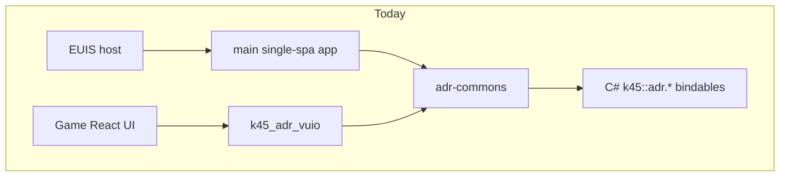
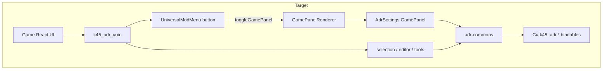
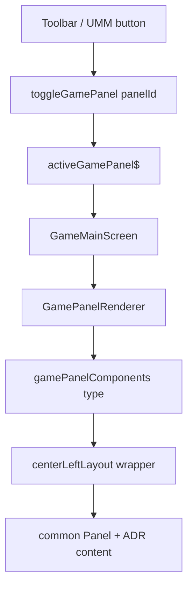

# 01 — Architecture and host

## Current dual-UI layout

Addresses ships **two** frontends today:

| Surface | Path | Host | Role |
|---------|------|------|------|
| Settings (full mod menu) | `_Frontends/UI/main/` | EUIS (Extra UI Screens) via single-spa | Namesets, overrides, road prefixes, region |
| Contextual chrome | `_Frontends/UI/k45_adr_vuio/` | Vanilla UI module (`AddUIModule`) | Selected-info sections, editor panel, road-marker tool options |

Shared domain layer: `@klyte45/adr-commons` (`engine.call` / `engine.on` facades).



## Target layout (after hard cut)



- **One** UI module: `k45_adr_vuio`
- Settings become an **additive** surface inside that module
- EUIS is **not** required; `main` is deleted from shipping

## Registration today vs target

### Today — EUIS (`AddressesCs2Mod.cs`)

- `UseEuisRegister = true`, `EuisIsMandatory = true`
- `EuisApps["main"]` → `k45-adr-main.js` / `.css` + ADR icon
- Bridge: `EuisExternalRegisterBridge.RegisterModForEUIS` / `RegisterAppForEUIS`
- Dev: `http://localhost:8715` when `LOCAL` is defined

### Today — VUIO (`DoOnLoad` + `index.tsx`)

- `AddUIModule` for asset named `k45_adr_vuio`
- `ModRegistrar` extends selected-info + mouse tool options; appends `Editor`

### Target — VUIO only

1. Keep `AddUIModule` for `k45_adr_vuio`
2. Register ADR settings as a **GamePanel** (same host path as Transportation Overview)
3. Add `moduleRegistry.append('UniversalModMenu', AdrUniversalModButton)` — button calls `toggleGamePanel(AdrSettingsPanelId)`
4. Remove EUIS registration entirely (see [09-euis-decommission.md](09-euis-decommission.md))

## Why Universal Mod Menu (not override a vanilla window)

Game evidence (UI modules cache):

- `UniversalModPanel` renders `ModdingHook` with `name: 'UniversalModMenu'`
- `RightMenu` shows the Paradox Mods glyph **only if** `hasAppend('UniversalModMenu')` is true
- `ModsMenu` itself is also a `GamePanelType` entry rendered by `GamePanelRenderer`

So appending to `UniversalModMenu`:

1. Makes the right-menu Mods button visible (if this mod is the first appender, or any other mod already appended)
2. Places ADR’s button inside the Universal Mod Panel button list
3. Avoids hijacking Options, Pause menu, or other vanilla panels

**Decision:** do **not** `override` / `extend` an existing vanilla settings window (Economy, City Info, …) for ADR city settings. Own **GamePanel** + UMM entry only.

## Settings shell = GamePanel (not EditorBindings Portal)

Confirmed UX: **vanilla-first**, on the **main game** panel host.

### Why EditorBindings `Portal` is wrong here

[`EditorBindings.tsx`](../../../_Frontends/UI/k45_adr_vuio/src/mods/EditorBindings.tsx) mounts via `moduleRegistry.append('Editor', …)` and uses `Portal` + `cs2/ui` `Panel`. That path is for the **asset editor** overlay. It is **not** how main-game overview windows are hosted: they do not participate in `activeGamePanel$`, layout slots (`centerLeftLayout`), or mutual exclusivity with Transportation / Economy / ModsMenu.

### Vanilla reference — Transportation Overview

From game UI modules:

1. Toolbar toggle → `useGamePanelState(GamePanelType.TransportationOverview)` → `toggleGamePanel(...)`
2. `GamePanelRenderer` looks up `gamePanelComponents[panel.__Type]`
3. Entry for transportation wraps content in `centerLeftLayout` and renders `TransportationOverviewPanel` with `{ selectedTab, onClose }`
4. Panel chrome is `game-ui/common/panel/panel.tsx` (`Panel` with `header`, `theme`, `onClose`, transition sounds) — **not** a free-floating Portal



### Sibling mod pattern (copy this)

Vehicle Skins / Write Everywhere already do the correct registration:

```ts
moduleRegistry.extend(
  "game-ui/game/data-binding/game-bindings.ts",
  "GamePanelType",
  (input) => { input["K45_ADR"] = AdrSettingsPanelId; return input; }
);
moduleRegistry.extend(
  "game-ui/game/components/game-panel-renderer.tsx",
  "gamePanelComponents",
  (input) => { input[AdrSettingsPanelId] = AdrSettingsPanel; return input; }
);
moduleRegistry.append("UniversalModMenu", AdrUniversalModButton);
// button: VanillaComponentResolver.instance.toggleGamePanel(AdrSettingsPanelId)
```

WE main UI also wraps with `gameMainScreenModule.centerLeftLayout` (same layout class Transportation Overview uses). Prefer that for a dense settings window.

### Content chrome inside the GamePanel

- Outer: GamePanel registration + `centerLeftLayout` (or equivalent layout div from `game-main-screen.module.scss`)
- Inner: `cs2/ui` / common `Panel` with `onClose` from renderer props; `PanelTitleBar` via `VanillaComponentResolver`
- Navigation: [`ListWithContentTab`](../../../_Frontends/UI/_shared/vuio-commons/src/components/ListWithContentTab.tsx) for the 4 root tabs

Do **not** recreate `MainSideTabMenuComponent` (EUIS icon rail). Do **not** use Editor `Portal` for this surface.

## Host / build differences implementers must respect

| Topic | EUIS `main` | VUIO `k45_adr_vuio` |
|-------|-------------|---------------------|
| React | Bundled in webpack | **External** from game (`react`, `react-dom`, `cs2/*`) |
| CSS | Separate `k45-adr-main.css` isolated by EUIS | Module CSS + `hasCSS` via `CSSPresencePlugin`; `publicPath: coui://ui-mods/` |
| Entry | single-spa `bootstrap/mount/unmount` | `export default register: ModRegistrar` |
| Widgets | euis-components + react-select + react-tabs | vuio-commons + vanilla `getModule` |
| Dev server | webpack-dev-server `:8715` | webpack watch → Mods folder / `dist/` |

## Binding contracts stay stable

Do not rename C# prefixes as part of this migration. Services in `adr-commons` continue to call `k45::adr.*`. UI host change must be transparent to C# systems.

## Related files

| File | Role |
|------|------|
| `BelzontAdr/AddressesCs2Mod.cs` | EUIS apps + VUIO `AddUIModule` |
| `_Frontends/UI/main/src/react-app.tsx` | single-spa entry (to delete) |
| `_Frontends/UI/k45_adr_vuio/src/index.tsx` | ModRegistrar (extend GamePanel + UMM) |
| `_Frontends/UI/k45_adr_vuio/types/modding.d.ts` | `AppendHookTargets` typing (extend for UniversalModMenu) |
| `game-ui/.../game-panel-renderer.tsx` | Vanilla `gamePanelComponents` map (extend) |
| `game-ui/.../transportation-overview-panel.tsx` | Reference overview shell |
| Vehicle Skins / WE `index.tsx` | Sibling GamePanel registration pattern |
