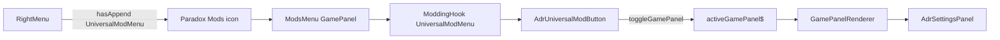

# 03 — Shell and Universal Mod Menu

## Goal

Register an ADR button on the vanilla Universal Mod Menu that toggles an ADR **GamePanel** hosting all former `main` content — same host path as Transportation Overview, not an Editor `Portal`.

## Game plumbing (verified)



Related vanilla pieces:

| Piece | Path / API |
|-------|------------|
| Panel type enum | `game-ui/game/data-binding/game-bindings.ts` → `GamePanelType` |
| Toggle / show / close | `toggleGamePanel` / `showGamePanel` / `closeGamePanel` |
| Visibility hook | `useGamePanelState(panelType)` |
| Component map | `game-ui/game/components/game-panel-renderer.tsx` → `gamePanelComponents` |
| Transport reference | `TransportationOverview` → `centerLeftLayout` + `TransportationOverviewPanel` |
| Common chrome | `game-ui/common/panel/panel.tsx` (`Panel` with `onClose`) |

- Append target string for UMM button list: **`UniversalModMenu`** (add to `AppendHookTargets` typings)
- Right-menu Mods glyph appears when **any** mod has appended to this hook
- Settings **content** is **not** parented under UniversalModPanel; UMM only opens the ADR GamePanel

## Registration sketch

In `_Frontends/UI/k45_adr_vuio/src/index.tsx` (pattern from Vehicle Skins / Write Everywhere):

```ts
import { ModRegistrar } from "cs2/modding";
import { AdrUniversalModButton } from "settings/AdrUniversalModButton";
import { AdrSettingsPanel, AdrSettingsPanelId } from "settings/AdrSettingsPanel";
// ... existing imports

const register: ModRegistrar = (moduleRegistry) => {
    moduleRegistry.extend(
        "game-ui/game/components/selected-info-panel/selected-info-sections/selected-info-sections.tsx",
        "selectedInfoSectionComponents",
        AddressesLayoutRegistering(() => { })
    );
    moduleRegistry.append("Editor", EditorBindings);
    moduleRegistry.extend(
        "game-ui/game/components/tool-options/mouse-tool-options/mouse-tool-options.tsx",
        "MouseToolOptions",
        AddressesToolOptions
    );

    // NEW — GamePanel registration (main game UI host)
    moduleRegistry.extend(
        "game-ui/game/data-binding/game-bindings.ts",
        "GamePanelType",
        (input) => {
            input["K45_ADR"] = AdrSettingsPanelId;
            return input;
        }
    );
    moduleRegistry.extend(
        "game-ui/game/components/game-panel-renderer.tsx",
        "gamePanelComponents",
        (input) => {
            input[AdrSettingsPanelId] = AdrSettingsPanel;
            return input;
        }
    );

    // NEW — UMM entry button
    moduleRegistry.append("UniversalModMenu", AdrUniversalModButton);
};

export default register;
```

Suggested panel id (stable string, same style as siblings):

```ts
export const AdrSettingsPanelId = "BelzontAdr.UI.AdrSettingsPanel";
```

### Typing update

[`types/modding.d.ts`](../../../_Frontends/UI/k45_adr_vuio/types/modding.d.ts) and [`vuio-commons/.../modding.d.ts`](../../../_Frontends/UI/_shared/vuio-commons/src/types/modding.d.ts):

Add **`"UniversalModMenu"`** to `AppendHookTargets`.

`toggleGamePanel` is already on `VanillaComponentResolver` in vuio-commons.

## Button component (`AdrUniversalModButton`)

Responsibilities:

1. Render a clickable row/button suitable for Universal Mod Panel (icon + title + short description)
2. On select: `VanillaComponentResolver.instance.toggleGamePanel(AdrSettingsPanelId)` — **not** local Portal state
3. Prefer ADR branding: `coui://adr.k45/UI/images/ADR.svg`
4. Localized label: reuse existing title strings under `K45::ADR.main[...]`

UX notes:

- Opening ADR settings closes other GamePanels (vanilla mutual exclusivity via `activeGamePanel$`) — expected
- Closing Universal Mod Panel does not require closing ADR settings (ModsMenu and ADR are separate GamePanel types)
- Optional: reflect selected state with `useGamePanelState(AdrSettingsPanelId)` if the UMM button chrome supports it

## Settings panel shell (`AdrSettingsPanel`)

### Do not use EditorBindings Portal

Wrong for main game:

```tsx
// Editor-only pattern — DO NOT use for ADR settings on main UI
<Portal>
  <Panel style={{ position: "absolute", ... }}>...</Panel>
</Portal>
```

That mounts outside `GamePanelRenderer`, skips `centerLeftLayout`, and fights the game’s panel stack.

### Correct structure (vanilla-first GamePanel)

Props from renderer: `{ onClose: () => void }` (and optionally `selectedTab` if you add tabbed panel data later).

```
div.centerLeftLayout   ← gameMainScreenModule.centerLeftLayout (see WE / TransportationOverview)
└─ Panel (common / cs2/ui; header + onClose)
   └─ ListWithContentTab (or equivalent)
        ├─ list: 4 root tabs
        │    Namesets | Overrides | Road prefixes | Region
        └─ body: selected tab content
```

Reference implementations:

| Reference | Takeaway |
|-----------|----------|
| `TransportationOverviewPanel` | `Panel` + header/tabs + `onClose`; hosted under `centerLeftLayout` by renderer map |
| Write Everywhere `WEMainPanel` | Explicit `centerLeftLayout` wrapper + `Panel` + `PanelTitleBar` + `toggleGamePanel` on close |
| Vehicle Skins `VSMainPanel` | GamePanel component receives `onClose`; uses `cs2/ui` `Panel` |

Sizing (target for a large settings surface):

| Dimension | Target | Notes |
|-----------|--------|-------|
| Height | **`70vh`** | Viewport-relative; apply on the settings `Panel` (or its root wrapper) |
| Width | **`80vw`** | Same |

This is the **initial size contract** for implementers. It may be tuned later during development (e.g. clamp min/max, or switch to rem if Gameface viewport units misbehave) — revisit in UI polish, do not block M0 on perfect fit.

Prefer setting size on the ADR panel root (CSS module) rather than fighting `centerLeftLayout` alone; keep the layout wrapper for GamePanel hosting, then size the inner `Panel`.

```tsx
// illustrative — exact class names left to implementers
<div className={gameMainScreenModule.centerLeftLayout}>
  <Panel className={styles.adrSettingsPanel} onClose={onClose} header={…}>
    …
  </Panel>
</div>
```

```scss
// settings panel root — review later in development
.adrSettingsPanel {
  width: 80vw;
  height: 70vh;
}
```


### Root tabs (replace `MainSideTabMenuComponent`)

Map from [`root.component.tsx`](../../../_Frontends/UI/main/src/root.component.tsx):

| Key | Label source | Content component (to port) |
|-----|--------------|-----------------------------|
| `namesets` | `namesetManagement.title` | `CityNamesetLibraryCmp` |
| `overrides` | `overrideSettings.title` | `OverrideSettingsCmp` |
| `roadPrefix` | `roadPrefixSettings.title` | `RoadPrefixCmp` |
| `region` | `regionSettings.title` | `RegionEditor` |

Icons (optional on list items): existing `coui://uil/...` / ADR image paths from `root.component.tsx`.

### City / editor loaded gate

Today `Root` blocks all tabs until `AdrMainService.isCityOrEditorLoaded()`.

In VUIO:

- Gate **panel body**, not the UMM button
- When not loaded: show centered warning using `translate("loadACityWarningH2")` (same key namespace)
- Re-check on open and on scene change if a binding/event exists; otherwise poll once on mount + when panel becomes visible (`useGamePanelState` / panel mount)

## Open / close / lifecycle

| Event | Expected behavior |
|-------|-------------------|
| UMM button click | `toggleGamePanel(AdrSettingsPanelId)` |
| Panel close (X / Escape via common Panel) | `onClose` from renderer → closes active GamePanel; unsubscribe listeners |
| Another GamePanel opens | ADR unmounts via panel stack — cleanup must run |
| City unload | Clear dirty local state; show gate warning if panel still open |
| Hot reload / mod reload | Safe: registration only via ModRegistrar |

**Critical:** every `engine.on` / `NamesetService.doOnCityNamesetsUpdated` / `DistrictRelativeService.onDistrictChanged` must clean up in `useEffect` return. GamePanel unmount (including when another overview opens) must not leak listeners.

## Error boundary

EUIS wrapped shell in `ErrorBoundary`. Options:

1. Port a minimal ErrorBoundary into vuio-commons (preferred for settings density)
2. Omit and rely on game React error handling (document risk)

Recommend option 1 in [04-widget-conversion-map.md](04-widget-conversion-map.md).

## What not to do

- Do **not** host settings with Editor `Portal` + absolute `Panel` (EditorBindings pattern)
- Do not register a second UI module asset just for settings
- Do not keep EUIS `main` app “for backup” (hard cut)
- Do not treat UMM as the content host — it only toggles the GamePanel
- Do not recreate EUIS `MainSideTabMenuComponent` SCSS chrome
- Do not override Economy / CityInfo / TransportationOverview panels for ADR content

## Checklist for implementers

- [ ] Typings include `UniversalModMenu`
- [ ] `GamePanelType` + `gamePanelComponents` extended with `AdrSettingsPanelId`
- [ ] `append('UniversalModMenu', …)` in `index.tsx`
- [ ] Button calls `toggleGamePanel`, not Portal state
- [ ] Panel uses `centerLeftLayout` (or renderer-equivalent) + common `Panel` + `onClose`
- [ ] Panel sized **70vh × 80vw** (tunable later in development)
- [ ] UMM button visible; right-menu Mods glyph present
- [ ] Panel opens with 4 root tabs; closes when another GamePanel opens
- [ ] City-not-loaded gate works
- [ ] Unmount unsubscribes all engine listeners
- [ ] Existing Editor / selected-info / tool registrations unchanged
