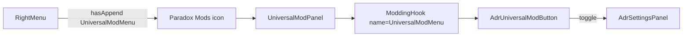

# 03 — Shell and Universal Mod Menu

## Goal

Register an ADR button on the vanilla Universal Mod Menu that opens/closes a custom settings `Panel` hosting all former `main` content.

## Game plumbing (verified)



- Append target string: **`UniversalModMenu`** (not in current `AppendHookTargets` union — update typings)
- Hook component renders all appended children in a scrollable button container
- Right-menu Mods button appears when **any** mod has appended to this hook

## Registration sketch

In `_Frontends/UI/k45_adr_vuio/src/index.tsx`:

```ts
import { ModRegistrar } from "cs2/modding";
import { AdrUniversalModButton } from "settings/AdrUniversalModButton";
// ... existing imports

const register: ModRegistrar = (moduleRegistry) => {
    moduleRegistry.extend(
        "game-ui/game/components/selected-info-panel/selected-info-sections/selected-info-sections.tsx",
        "selectedInfoSectionComponents",
        AddressesLayoutRegistering(() => { })
    );
    moduleRegistry.append("Editor", EditorBindings);
    moduleRegistry.extend(
        "game-ui/game/components/tool-options/mouse-tool-options/mouse-tool-options.tsx",
        "MouseToolOptions",
        AddressesToolOptions
    );

    // NEW
    moduleRegistry.append("UniversalModMenu", AdrUniversalModButton);
};

export default register;
```

### Typing update

[`types/modding.d.ts`](../../../_Frontends/UI/k45_adr_vuio/types/modding.d.ts) and [`vuio-commons/.../modding.d.ts`](../../../_Frontends/UI/_shared/vuio-commons/src/types/modding.d.ts) currently declare:

```ts
export type AppendHookTargets =
  | "Menu" | "Editor" | "Game"
  | "GameTopLeft" | "GameTopRight" | "GameBottomRight";
```

Add **`"UniversalModMenu"`** to that union (and keep the string overload of `append` working).

## Button component (`AdrUniversalModButton`)

Responsibilities:

1. Render a clickable row/button suitable for Universal Mod Panel (icon + title + short description)
2. Toggle visibility of `AdrSettingsPanel` (React state or small shared store/module singleton)
3. Prefer ADR branding: `coui://adr.k45/UI/images/ADR.svg`
4. Localized label: reuse existing title strings under `K45::ADR.main[...]` (e.g. mod title / “Addresses & Names”)

UX notes:

- Closing Universal Mod Panel should **not** necessarily destroy the settings panel (decide explicitly: recommended — settings panel is independent; UMM button only opens/focuses it)
- Selected state on the UMM button when ADR panel is open (if the hook’s button API supports it; otherwise ignore)

## Settings panel shell (`AdrSettingsPanel`)

### Structure (vanilla-first)

```
Portal
└─ Panel (header = mod title / close)
   └─ ListWithContentTab (or equivalent)
        ├─ list: 4 root tabs
        │    Namesets | Overrides | Road prefixes | Region
        └─ body: selected tab content
```

Reference: [`EditorBindings.tsx`](../../../_Frontends/UI/k45_adr_vuio/src/mods/EditorBindings.tsx) for `Portal` + `Panel` sizing (`rem` units).

Suggested sizing: wider than editor panel (settings are dense). Start around `900rem`–`1200rem` width; height constrained with scrollable body.

### Root tabs (replace `MainSideTabMenuComponent`)

Map from [`root.component.tsx`](../../../_Frontends/UI/main/src/root.component.tsx):

| Key | Label source | Content component (to port) |
|-----|--------------|-----------------------------|
| `namesets` | `namesetManagement.title` | `CityNamesetLibraryCmp` |
| `overrides` | `overrideSettings.title` | `OverrideSettingsCmp` |
| `roadPrefix` | `roadPrefixSettings.title` | `RoadPrefixCmp` |
| `region` | `regionSettings.title` | `RegionEditor` |

Icons (optional on list items): existing `coui://uil/...` / ADR image paths from `root.component.tsx`.

### City / editor loaded gate

Today `Root` blocks all tabs until `AdrMainService.isCityOrEditorLoaded()`.

In VUIO:

- Gate **panel body**, not the UMM button
- When not loaded: show centered warning using `translate("loadACityWarningH2")` (same key namespace)
- Re-check on open and on scene change if a binding/event exists; otherwise poll once on mount + when panel becomes visible

## Open / close / lifecycle

| Event | Expected behavior |
|-------|-------------------|
| UMM button click | Open panel if closed; optionally focus/bring-to-front if open |
| Panel close (X / Escape if supported) | Unmount or hide; unsubscribe `engine.on` listeners |
| City unload | Clear dirty local state; show gate warning if panel still open |
| Hot reload / mod reload | Safe: no singleton assuming EUIS mount |

**Critical:** every `engine.on` / `NamesetService.doOnCityNamesetsUpdated` / `DistrictRelativeService.onDistrictChanged` must clean up in `useEffect` return. EUIS unmount was per-app; VUIO panel hide must not leak listeners.

## Error boundary

EUIS wrapped shell in `ErrorBoundary`. Options:

1. Port a minimal ErrorBoundary into vuio-commons (preferred for settings density)
2. Omit and rely on game React error handling (document risk)

Recommend option 1 in [04-widget-conversion-map.md](04-widget-conversion-map.md).

## What not to do

- Do not register a second UI module asset just for settings
- Do not keep EUIS `main` app “for backup” (hard cut)
- Do not append to `GameTopLeft` / `Game` as the primary entry (UMM is the product entry)
- Do not recreate EUIS `MainSideTabMenuComponent` SCSS chrome

## Checklist for implementers

- [ ] Typings include `UniversalModMenu`
- [ ] `append('UniversalModMenu', …)` in `index.tsx`
- [ ] UMM button visible in-game; right-menu Mods glyph present
- [ ] Panel opens with 4 root tabs
- [ ] City-not-loaded gate works from menu / editor / game
- [ ] Panel close unsubscribes all engine listeners
- [ ] Existing Editor / selected-info / tool registrations unchanged
