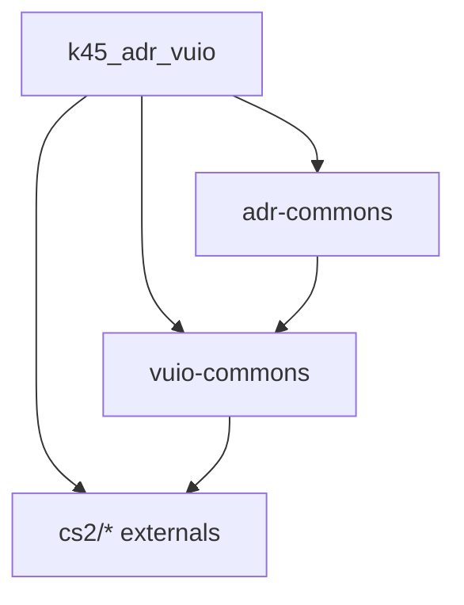

# 08 — Shared libraries

## Packages involved

| Package | Path | Role after migration |
|---------|------|----------------------|
| `@klyte45/adr-commons` | `_Frontends/UI/_shared/adr-commons/` | **Keep** — domain services/models for all ADR UI |
| `@klyte45/vuio-commons` | `_Frontends/UI/_shared/vuio-commons/` | **Keep / extend** — vanilla widgets + MultiUI bindings |
| `@klyte45/euis-components` | `_Frontends/UI/_replacements/euis-components/` | **Drop from ADR** after port |
| `@k45/adr-main` | `_Frontends/UI/main/` | **Delete** after port |

## adr-commons — current EUIS coupling

[`adr-commons/index.tsx`](../../../_Frontends/UI/_shared/adr-commons/index.tsx) today:

```ts
///<reference path="../../_replacements/euis-components/types/euis.d.ts" />
///<reference path="../../_replacements/euis-components/types/cohtml.d.ts" />
///<reference path="../../_replacements/euis-components/types/declarations.d.ts" />

export * from "../../_replacements/euis-components/src/utility/Entity"
export * from "../../_replacements/euis-components/src/utility/name.utils"
```

Also `RegionService.tsx` imports `Entity` from euis-components path.

### Mandatory retarget

| Item | Action |
|------|--------|
| Triple `reference` paths to euis types | Point at `vuio-commons` typings (`cohtml.d.ts`, etc.) or k45_adr_vuio `types/` |
| Re-export `Entity` / `name.utils` | Switch to `vuio-commons` (`src/utils/Entity`, `src/utils/name.utils`) — already exist |
| `RegionService` Entity import | Same |
| DevDeps on react-select / single-spa / systemjs / emotion | Remove if unused after EUIS exit |
| Package.json of adr-commons | Clean EUIS-only tarball deps |

After retarget, **both** former `main` consumers and `k45_adr_vuio` use the same commons without EUIS on the path.

## adr-commons — keep as-is (API surface)

Services/models that should remain:

- `DistrictRelativeService`
- `GitHubAddressesFilesService`
- `NamesetService`
- `NamingRulesService`
- `SelectInfoPanelService` + `SelectInfoPanelModels`
- `EditorUISystemService`
- `VehicleService`
- `AdrMainService`
- `HighwayRoutesService`
- `RegionService`

No need to split commons into “settings” vs “contextual” packages.

## vuio-commons — extend during migration

Documented in [04](04-widget-conversion-map.md). Likely additions:

- `FormLine`
- `TriCheckbox`
- `ErrorBoundary`
- Optional color field

Also update `AppendHookTargets` in vuio-commons `modding.d.ts` to include `UniversalModMenu`.

## Kill list (ADR product)

| Artifact | When to remove |
|----------|----------------|
| `_Frontends/UI/main/` entire project | After M5 parity + M6 cut |
| ADR dependency on `@klyte45/euis-components` | When no ADR TS file imports it |
| `main` webpack / jest / babel configs | With `main` delete |
| EUIS registration in `AddressesCs2Mod` | Hard cut ([09](09-euis-decommission.md)) |
| Patched tarballs **if ADR-only**: emotion cache, systemjs-webpack-interop, react-select | Only if no other workspace package needs them |

**Do not** delete `_replacements/euis-components` from disk in this ADR sprint if other Belzont/Klyte mods still consume it via shared tree — only stop ADR from depending on it. Confirm with sibling mods before deleting the replacement package itself.

## Dependency graph (target)



No edge to euis-components.

## Implementer checklist

- [ ] `adr-commons` builds/typechecks without `_replacements/euis-components`
- [ ] `k45_adr_vuio` still compiles against adr-commons
- [ ] Grep ADR repo: zero `@klyte45/euis-components` imports
- [ ] Grep ADR repo: zero `#components` aliases pointing at deleted `main`
- [ ] Solution / frontend csproj packaging no longer copies `k45-adr-main.js/css`
