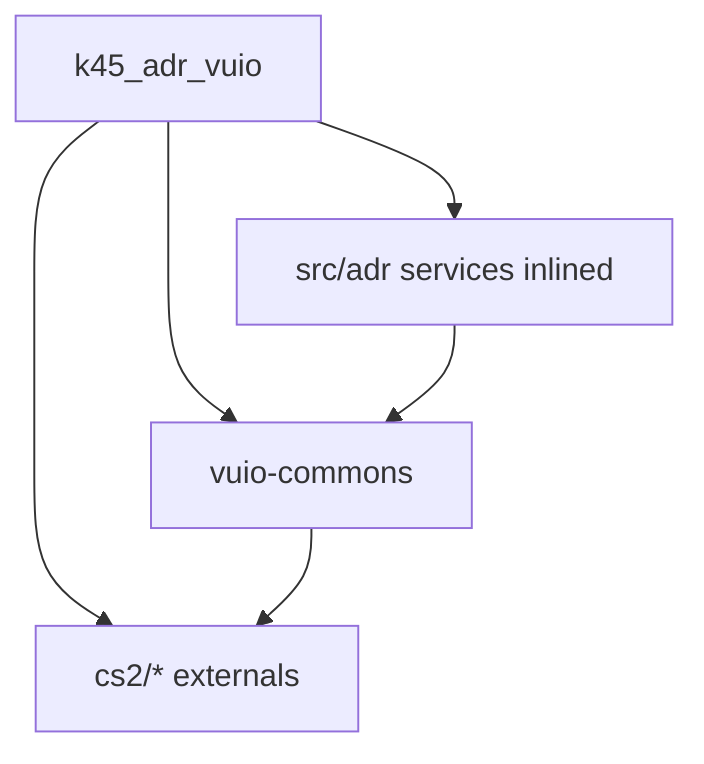

# 08 — Shared libraries

## Inlining `adr-commons` into `k45_adr_vuio` (viable — recommended after `main` is gone)

### Validation (repo evidence)

| Question | Finding |
|----------|---------|
| Who depends on `@klyte45/adr-commons`? | **Only** ADR UI: `main` + `k45_adr_vuio` (`package.json` `file:` deps). No other Belzont mod imports it in TS (ExtraUIScreens has a stale `package.json` entry pointing at a non-ADR path; no source imports). |
| After `main` delete? | **Single consumer:** `k45_adr_vuio` |
| Package size? | ~11 small TS files under `src/` (~16 KB) — services + one model file |
| Overlap with vuio-commons? | `Entity`, `name.utils` / `replaceArgs`, `EnumValueType` already exist in vuio-commons; adr-commons currently re-exports EUIS copies of Entity/name.utils |
| Webpack? | VUIO already bundles TS via `ts-loader`; moving sources under `k45_adr_vuio/src/` needs no special packaging |

**Verdict: viable.** After EUIS `main` is removed, a separate npm package is optional overhead. Prefer folding ADR-domain services into the VUIO module and deleting `_shared/adr-commons`.

### Recommended layout

```
k45_adr_vuio/src/
  adr/                         # was _shared/adr-commons/src
    service/
      NamesetService.tsx
      NamingRulesService.tsx
      …
    model/
      SelectInfoPanelModels.ts
  …
```

Import style: relative (`adr/service/NamesetService`) or a path alias (`#adr/*`) — drop `@klyte45/adr-commons` from `package.json`.

### When inlining, also

1. **Retarget utils:** import `Entity` / `nameToString` / `replaceArgs` / `EnumValueType` from `@klyte45/vuio-commons` (or local re-exports) — do not keep EUIS paths
2. **Strip** adr-commons EUIS triple-`reference` and EUIS-only package.json tarball deps
3. **Delete** `_Frontends/UI/_shared/adr-commons/` once imports are updated
4. Keep **vuio-commons** shared (used by WE/VS/ADR) — only ADR-domain RPC facades move

### When to keep a separate package instead

Keep `_shared/adr-commons` only if you expect a **second ADR frontend** (tests, tools UI, another module) soon. Otherwise inlining is simpler.

### Relation to earlier “retarget” plan

Either path works:

| Path | Action |
|------|--------|
| **A (recommended)** | Inline into `k45_adr_vuio` + consume vuio-commons utils |
| **B** | Keep package, only retarget EUIS → vuio-commons as in “Mandatory retarget” above |

Do **not** leave adr-commons coupled to `_replacements/euis-components` either way.

## Packages involved

| Package | Path | Role after migration |
|---------|------|----------------------|
| `@klyte45/adr-commons` | `_Frontends/UI/_shared/adr-commons/` | **Prefer delete** after inlining into `k45_adr_vuio` (or keep + EUIS retarget if Path B) |
| `@klyte45/vuio-commons` | `_Frontends/UI/_shared/vuio-commons/` | **Keep / extend** — vanilla widgets + MultiUI bindings + shared Entity/name utils |
| `@klyte45/euis-components` | `_Frontends/UI/_replacements/euis-components/` | **Drop from ADR** after port |
| `@k45/adr-main` | `_Frontends/UI/main/` | **Delete** after port |

## adr-commons — current EUIS coupling

[`adr-commons/index.tsx`](../../../_Frontends/UI/_shared/adr-commons/index.tsx) today:

```ts
///<reference path="../../_replacements/euis-components/types/euis.d.ts" />
///<reference path="../../_replacements/euis-components/types/cohtml.d.ts" />
///<reference path="../../_replacements/euis-components/types/declarations.d.ts" />

export * from "../../_replacements/euis-components/src/utility/Entity"
export * from "../../_replacements/euis-components/src/utility/name.utils"
```

Also `RegionService.tsx` imports `Entity` from euis-components path.

### Mandatory retarget

| Item | Action |
|------|--------|
| Triple `reference` paths to euis types | Point at `vuio-commons` typings (`cohtml.d.ts`, etc.) or k45_adr_vuio `types/` |
| Re-export `Entity` / `name.utils` | Switch to `vuio-commons` (`src/utils/Entity`, `src/utils/name.utils`) — already exist |
| `RegionService` Entity import | Same |
| DevDeps on react-select / single-spa / systemjs / emotion | Remove if unused after EUIS exit |
| Package.json of adr-commons | Clean EUIS-only tarball deps |

After retarget, **both** former `main` consumers and `k45_adr_vuio` use the same commons without EUIS on the path.

## adr-commons — keep as-is (API surface)

Services/models that should remain:

- `DistrictRelativeService`
- `GitHubAddressesFilesService`
- `NamesetService`
- `NamingRulesService`
- `SelectInfoPanelService` + `SelectInfoPanelModels`
- `EditorUISystemService`
- `VehicleService`
- `AdrMainService`
- `HighwayRoutesService`
- `RegionService`

No need to split commons into “settings” vs “contextual” packages.

## vuio-commons — extend during migration

Documented in [04](04-widget-conversion-map.md). Likely additions / exposures:

- `FormLine`
- **Expose game `Checkbox` `multistate` / `onMultistateChange`** in `VanillaWidgets.CheckboxProps` (three-state already exists in game UI — statistics panel uses it; not a greenfield TriCheckbox)
- Optional thin `TriCheckbox` helper only to map ADR `null` ↔ game `undefined`
- `ErrorBoundary`
- Optional color field
- Optional: **`FilePickerDialog` error-modal mode** (message + primary/secondary actions) if not implemented as an ADR-only wrapper — needed for GitHub rate-limit UX

**Already available — reuse, do not rebuild:** `FilePickerDialog`, `BaseFileService`, `StringInputDialog*`, `ListWithContentTab`, `MultiUIValueBinding`, two-state `Checkbox`. (`K45HierarchyMenu` stays in vuio-commons for other consumers; **ADR city namesets do not use it.**)

Also update `AppendHookTargets` in vuio-commons `modding.d.ts` to include `UniversalModMenu`.

## Kill list (ADR product)

| Artifact | When to remove |
|----------|----------------|
| `_Frontends/UI/main/` entire project | After M5 parity + M6 cut |
| ADR dependency on `@klyte45/euis-components` | When no ADR TS file imports it |
| `main` webpack / jest / babel configs | With `main` delete |
| EUIS registration in `AddressesCs2Mod` | Hard cut ([09](09-euis-decommission.md)) |
| Patched tarballs **if ADR-only**: emotion cache, systemjs-webpack-interop, react-select | Only if no other workspace package needs them |

**Do not** delete `_replacements/euis-components` from disk in this ADR sprint if other Belzont/Klyte mods still consume it via shared tree — only stop ADR from depending on it. Confirm with sibling mods before deleting the replacement package itself.

## Dependency graph (target)



No edge to euis-components or a separate adr-commons package (Path A).

If Path B (keep package): `k45_adr_vuio → adr-commons → vuio-commons` instead of inlining.

## Implementer checklist

- [ ] Prefer Path A: move adr-commons sources under `k45_adr_vuio/src/adr/`; remove `@klyte45/adr-commons` dep
- [ ] Or Path B: `adr-commons` builds/typechecks without `_replacements/euis-components`
- [ ] Utils (`Entity`, `name.utils`, `EnumValueType`) come from vuio-commons
- [ ] `k45_adr_vuio` compiles; selection-info + settings both work
- [ ] Grep ADR repo: zero `@klyte45/euis-components` / `@klyte45/adr-commons` (if Path A)
- [ ] Grep ADR repo: zero `#components` aliases pointing at deleted `main`
- [ ] Solution / frontend csproj packaging no longer copies `k45-adr-main.js/css`
- [ ] `_shared/adr-commons/` deleted if Path A
