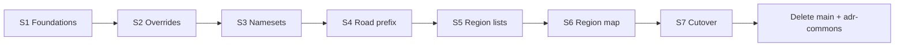

# 11 — Sprint roadmap (implementation strategy)

Multi-sprint plan to recreate EUIS `main` settings inside `k45_adr_vuio`, then **hard-cut** EUIS. Detailed specs live in [00–10](00-README.md); this file is the **execution order and sprint gates**.

## Strategy summary

| Principle | Choice |
|-----------|--------|
| Feature order | Shell → Overrides → Namesets → Road prefix → Region lists → Region map → Cutover |
| Releases | **No player-facing releases until S7 completes** — build UMM/GamePanel from S1 for dev/parity; EUIS `main` stays in repo until S7 deletion |
| Domain package | Keep `@klyte45/adr-commons` until **S7**; then **inline** into `k45_adr_vuio/src/adr/` and delete the package |
| Rollout | Hard cut in S7 — no EUIS fallback after that release |
| Binding / i18n | Do not rename `k45::adr.*` or `K45::ADR.main[...]` in this roadmap |

**Final sprint objective (S7):** remove `_Frontends/UI/main/` and `_Frontends/UI/_shared/adr-commons/` from the product, disable EUIS registration, and ship VUIO-only settings via Universal Mod Menu + GamePanel.

---

## Cross-sprint rules

1. Follow conversion maps: [04](04-widget-conversion-map.md), [05](05-styles-conversion.md), [06](06-behaviors-and-bindings.md).
2. Agents: MCP for game UI research; no CSS `gap`/Grid; never edit `i18n.csv` ([00](00-README.md) agent rules).
3. Until S7: settings code may import `@klyte45/adr-commons` unchanged.
4. Until S7: do **not** delete `main`, stop shipping `k45-adr-main`, or clear `EuisApps` / `EuisIsMandatory`.
5. Do **not** port `DefaultPanelScreen`, `Cs2SideTabs`, nameset hierarchy, or Editor `Portal` for settings.
6. Frontend builds: agents may run npm; ask the user to compile C# when `AddressesCs2Mod` / packaging changes (S7).

---

## Sprint 1 — Foundations (shell + shared widgets)

**Goal:** Empty ADR settings GamePanel opens from UMM; vuio-commons gaps needed by later sprints exist.

### Deliverables

| Item | Notes |
|------|--------|
| `UniversalModMenu` typings | vuio + vuio-commons `AppendHookTargets` |
| `GamePanelType` + `gamePanelComponents` | VS/WE pattern — [03](03-shell-and-umm.md) |
| `AdrUniversalModButton` | `toggleGamePanel(AdrSettingsPanelId)` |
| `AdrSettingsPanel` | `centerLeftLayout` + `Panel`; **70vh × 80vw**; city-loaded gate |
| Root nav placeholders | `ListWithContentTab` for 4 tabs (empty bodies) |
| vuio-commons | `FormLine`; expose `Checkbox` **multistate**; `ErrorBoundary`; optional `ColorField` / FilePicker error-modal prep — [04](04-widget-conversion-map.md), [08](08-shared-libs.md) |
| `settings/translate.ts` | Still resolves `K45::ADR.main[...]` — [10](10-i18n-and-assets.md) |

### Exit criteria

- [ ] Right-menu Mods glyph appears when ADR appends UMM
- [ ] UMM button opens/closes ADR GamePanel (not Editor Portal)
- [ ] Panel sized ~70vh × 80vw; closes when another GamePanel opens
- [ ] Multistate `Checkbox` typed and usable from vuio-commons
- [ ] EUIS `main` still in repo (removed in S7 only)

**Maps to:** [07](07-tab-by-tab-migration.md) M0 (+ commons prep for M1–M3).

---

## Sprint 2 — Overrides

**Goal:** Full override settings parity inside the VUIO GamePanel.

### Deliverables

- Port `OverrideSettingsCmp` with nested **`ListWithContentTab`** (14 tabs + H2 section headers) — no `Cs2SideTabs`
- Port citizen / roads-districts / address-format / vehicle plate / vehicle serial tabs
- Plate/serial via vuio-commons MultiUI bindings
- Feature CSS modules under `settings/styles/`

### Exit criteria

- [ ] All 14 subtabs editable; values persist via existing binders
- [ ] Nameset dropdowns refresh when city namesets change
- [ ] No euis-components imports in overrides folder
- [ ] Contextual VUIO (selection/editor/tool) unchanged
- [ ] EUIS `main` still in repo

**Maps to:** [07](07-tab-by-tab-migration.md) M1 · inventory [02](02-feature-inventory.md).

---

## Sprint 3 — Namesets

**Goal:** City nameset library + disk/GitHub import/export CRUD on VUIO.

### Deliverables

- Flat raw-name left list (`ListWithContentTab`); **no** hierarchy / `categorizeFiles` / category components
- Disk + GitHub browse via **`FilePickerDialog` only**
- GitHub rate-limit / listing failure → error modal: **Open GitHub** + **Cancel** (new Cancel string via `*_entries.txt` if needed)
- Editor / import / view / delete flows with `StringInputDialog` / dialogs as mapped in [04](04-widget-conversion-map.md)
- `EditorScrollable` instead of EUIS `GameScrollComponent`

### Exit criteria

- [ ] Full CRUD + disk library + GitHub import + export
- [ ] City library shows flat raw names
- [ ] No custom folder-browser UI left in ported code
- [ ] EUIS `main` still in repo

**Maps to:** [07](07-tab-by-tab-migration.md) M2.

---

## Sprint 4 — Road prefix

**Goal:** Road prefix rules editor parity (depends on S1 multistate Checkbox).

### Deliverables

- Port `RoadPrefixCmp` + CSS module
- Tri-state flags via game `Checkbox` `multistate` (`null`↔`undefined` mapping if C# still uses null)
- Defaults save/load XML path via **`FilePickerDialog`** when picking from disk

### Exit criteria

- [ ] Reorder, flags, save/load defaults work from VUIO panel
- [ ] EUIS `main` still in repo

**Maps to:** [07](07-tab-by-tab-migration.md) M3.

---

## Sprint 5 — Region lists

**Goal:** Region editor shell + highway/city list editors (no map parity yet).

### Deliverables

- `RegionEditor` without `react-tabs` (vanilla / ListWithContentTab strip)
- Highway register + region cities management + generic listing
- Color input (vuio-commons or local)
- Map area may be **stubbed** during S5 only (e.g. disabled “select on map”) — must be completed in S6

### Exit criteria

- [ ] Highways + cities editable from VUIO list UI
- [ ] Region tab navigable; no `react-tabs` dependency
- [ ] Map stub acceptable for S5 exit; **not** acceptable for S7 cutover
- [ ] EUIS `main` still in repo

**Maps to:** [07](07-tab-by-tab-migration.md) M4.

---

## Sprint 6 — Region map (parity gate)

**Goal:** Full region map parity — **hard gate** before cutover. Do not start S7 until this sprint is green.

### Deliverables

- `MapDiv` + map/region SCSS modules + `svgutils`
- Pan/zoom, double-click selection, outside-connection markers, highway/rail/urban overlays, neighborhood sectors, HUD, selected highway highlight — full list in [07](07-tab-by-tab-migration.md) M5

### Exit criteria

- [ ] **All** M5 map checklist items pass in-game
- [ ] No stubbed “select on map” left
- [ ] EUIS `main` still in repo (last feature sprint before deletion)

**Maps to:** [07](07-tab-by-tab-migration.md) M5.

---

## Sprint 7 — Cutover (remove `main` + `adr-commons`)

**Goal:** Ship VUIO-only settings; delete EUIS `main` project and the `adr-commons` package after inlining.

This is the **only** sprint that removes those projects. Do not start until S1–S6 exit criteria are green.

### Phase A — Domain inline (Path A)

| Step | Action |
|------|--------|
| 1 | Copy `_shared/adr-commons/src` → `k45_adr_vuio/src/adr/` |
| 2 | Retarget `Entity` / `name.utils` / `EnumValueType` to `@klyte45/vuio-commons` |
| 3 | Update all VUIO imports off `@klyte45/adr-commons` |
| 4 | Drop `@klyte45/adr-commons` from `k45_adr_vuio/package.json` |
| 5 | Delete `_Frontends/UI/_shared/adr-commons/` |
| 6 | Grep clean: no `@klyte45/adr-commons` in ADR product paths |

Detail: [08](08-shared-libs.md).

### Phase B — EUIS hard cut + delete `main`

| Step | Action |
|------|--------|
| 1 | Confirm UMM + GamePanel is the settings entry (parity proven in S6) |
| 2 | C#: remove/disable `UseEuisRegister` / `EuisIsMandatory` / `EuisApps` — [09](09-euis-decommission.md) |
| 3 | Stop packaging `k45-adr-main.js` / `.css`; remove build hooks for `main` |
| 4 | Delete `_Frontends/UI/main/` |
| 5 | Strip ADR deps on `@klyte45/euis-components` / EUIS tarballs |
| 6 | Player-facing docs/changelog: Universal Mod Menu; no Extra UI Screens requirement |

### Phase C — Verification

- [ ] Fresh playset **without** EUIS: ADR loads
- [ ] Mods glyph + UMM opens full settings (all four root tabs)
- [ ] No errors about `k45-adr-main` / EUIS bridge
- [ ] Contextual VUIO still works
- [ ] `rg` clean for product paths: `euis-components`, `k45-adr-main`, `EuisApps`, `UseEuisRegister`, `@klyte45/adr-commons`, `_Frontends/UI/main`
- [ ] Folders gone: `_Frontends/UI/main/`, `_Frontends/UI/_shared/adr-commons/`

### Exit criteria (roadmap done)

- [ ] `_Frontends/UI/main/` removed
- [ ] `_Frontends/UI/_shared/adr-commons/` removed
- [ ] ADR ships settings only via `k45_adr_vuio` GamePanel + UMM
- [ ] EUIS not required
- [ ] First player-facing release after this sprint

**Maps to:** [07](07-tab-by-tab-migration.md) M6 · [09](09-euis-decommission.md) · [08](08-shared-libs.md) Path A.

---

## Suggested PR slicing (within sprints)

| Sprint | Example PR slices |
|--------|-------------------|
| S1 | Commons widgets → shell/UMM → empty tabs |
| S2 | Override shell + nested list → citizen/roads → plates/serial |
| S3 | City library flat list → disk picker → GitHub picker + error modal → editor CRUD |
| S4 | Multistate wiring smoke → full road prefix |
| S5 | Region shell → highway/city lists |
| S6 | Map core → overlays → parity polish |
| S7 | Inline adr → EUIS off + packaging → delete `main` + `adr-commons` → changelog |

---

## Explicit non-goals (entire roadmap)

- Renaming `k45::adr.*` binders or `K45::ADR.main[...]` keys
- Moving selection-info / tool / editor into `settings/`
- Keeping Path B (`adr-commons` package) after S7
- EUIS fallback period after S7 ships
- Kanban board task creation (unless separately requested)

---

## Open questions

All cleared.

### Dual entry during S1–S6

**Decision:** No player-facing releases until **S7** completes. Register UMM/GamePanel from S1 for dev/parity testing; do not optimize for dual player entry or LOCAL-only UMM gating.

### Sprint 5 sizing

**Decision:** Split Region across two sprints — **S5** = lists/shell only; **S6** = map parity gate; **S7** = cutover (remove `main` + `adr-commons`).

### S7 sequencing (cutover)

**Decision:** **Phase A then B** in S7 — inline `adr-commons` into `k45_adr_vuio/src/adr/` and drop the package **before** EUIS hard cut and deleting `main`.
