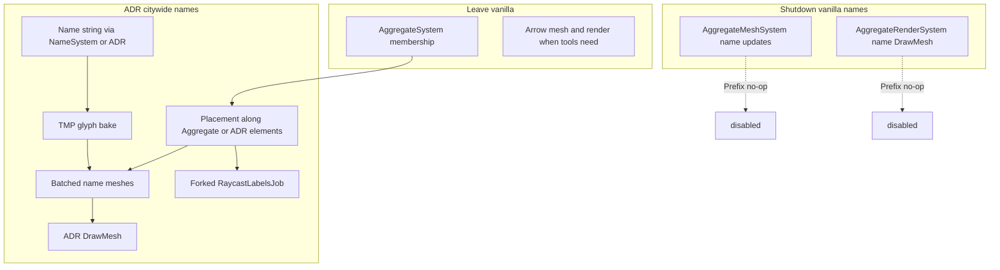

# ADR citywide road name-label takeover

*Added: 2026-09-11 · Depends on [14](14-vanilla-road-label-pipeline.md) · Game.dll build GUID `d124bec16c0748da9ebf48366d9c1d68`*

## Purpose

Lock the **architecture** for ADR owning **all** world road **name** labels: shut down vanilla name mesh/draw, leave membership and arrows alone, provide ADR bake/place/draw/pick with settled product policy.

This **supersedes** the “thin ADR labels only on associated edges + suppress vanilla” sketch in [06](06-labels-vs-vanilla-sync-and-harmony.md) for the **label epic**. Parallel membership / NameSystem / GetAddress decisions in [00](00-README.md)–[04](04-parallel-system-design-notes.md) stay.

## Settled product policy

| Topic | Choice |
|-------|--------|
| Scope | **Citywide** road **name** labels only |
| Membership | Vanilla `AggregateSystem` **unchanged** |
| Arrows | Vanilla arrow mesh/render path **unchanged** |
| When active | **Always-on** when ADR loads — no player-facing vanilla-label fallback |
| Phase-1 look | **Parity-only** — match vanilla; knobs / TMP sprites deferred ([17](17-label-extensions-text-images-look.md) feasibility only) |
| Pick owner (unassociated) | **S1** — vanilla `Aggregate` entity |
| Pick owner (ADR-associated) | **S2** — ADR name-aggregate entity ([06](06-labels-vs-vanilla-sync-and-harmony.md)) |
| SIP (label epic) | Sections that activate for vanilla `Aggregate` must also work for **S2** ADR name-aggregate (catalog **LBL-05** — [18](18-label-takeover-sprint-roadmap.md); design archive [06](06-labels-vs-vanilla-sync-and-harmony.md)) |

## Shutdown levers (vanilla names)

Do **not** Harmony-patch Burst `AggregateSystem` or Burst job bodies inside placement.

Preferred managed surfaces:

1. **`AggregateMeshSystem.OnUpdate`** — skip name half only:
   - Skip / Prefix-out: `UpdateLabelVertices`, `UpdateLabelPositions`, `FillNameMeshData`
   - Still allow: prefab init as needed for arrows, `UpdateArrowMaterials` / `UpdateArrowPositions` / `FillArrowMeshData`
2. **`AggregateRenderSystem.Render`** — Prefix so the **name** `GetNameMesh` / `DrawMesh` loop never runs; leave the `requireNetArrows` arrow branch intact.

Either lever alone can hide names; both together avoid wasted TMP/mesh work **and** empty draws. Prefer **both** for always-on takeover.

## ADR ownership stack

```text
                    ┌── AggregateSystem (vanilla membership) ── keep
Edge ──Aggregated──►│
                    └── ADRNameAggregated? (optional parallel) ── naming / S2
                            │
                            ▼
              ADR name-label systems (citywide)
                            │
        ┌───────────────────┼───────────────────┐
        ▼                   ▼                   ▼
   String (NameSystem)  Placement source    Forked pick
   TMP → vertices       AggregateElement    RaycastSystem hook
   Extents              or ADRNameAggregate Element
        │                   │                   │
        └─────────► Batched mesh + DrawMesh ◄───┘
```

### String → TMP → `LabelVertex`

Port the managed bake pattern from vanilla `UpdateLabelVertices` ([14](14-vanilla-road-label-pipeline.md)):

- Same TMP defaults for parity (`sizeDelta` 250×100, `fontSize` 200, center).
- Material clone + `OverlayRenderSystem.CopyFontAtlasParameters`.
- Dirty via `Updated` on label owners (same idea as `AdrMainSystem.ResetRoadsCache`).

### Placement

Port / adapt `UpdateLabelPositionsJob` + `AddLabels`:

| Road state | Edge list for placement | Name entity for string / pick |
|------------|-------------------------|-------------------------------|
| No ADR association | Vanilla `AggregateElement` | Vanilla `Aggregate` (S1) |
| ADR-associated | `ADRNameAggregateElement` | ADR name-aggregate (S2) |

Keep spacing constant `100f` and `m_MaxScale` formula for parity unless a later epic adds knobs.

### Draw

ADR `Graphics.DrawMesh` path mirroring name half of `AggregateRenderSystem` (respect `hideOverlay`; do not steal arrow draws).

### Pick

1. Fork `Game.Net.RaycastJobs.RaycastLabelsJob` (~150 lines Burst).
2. Resolve owner: ADR association on edge → S2 ADR aggregate; else S1 vanilla Aggregate.
3. Schedule from managed Harmony on `RaycastSystem` when `TypeMask.Labels` (same frame plumbing as vanilla `jobData19`).
4. Do **not** patch the vanilla Burst job body.

With citywide draw ownership, vanilla name meshes are empty/disabled, so dual-label click ambiguity is avoided without per-edge suppress heuristics.

## Coexistence rules

| System | ADR action |
|--------|------------|
| `AggregateSystem` | Leave running |
| Arrow mesh/render | Leave running |
| Name mesh/render | Disabled (always-on) |
| `NameSystem` / GetAddress | Already / activation-wave ADR preference for associated edges — independent of draw ownership |
| Road Grouping overlays | Tool feedback only — **not** a substitute for city labels ([10](10-road-grouping-overlay-render-system.md)) |
| SIP Aggregate-gated sections | **In label epic (LBL-05)** — parity with vanilla Aggregate SIP when S2 selected ([18](18-label-takeover-sprint-roadmap.md) / [06](06-labels-vs-vanilla-sync-and-harmony.md)) |
| DefaultTool H1 highlight | Prefer with LBL-05; spill **LBL-08** if needed |

## Relation to activation sprint

Activation ([13](13-activation-sprint-roadmap.md) ACT-01…ACT-06) delivers ADR membership + name/address preference + tool mutations. **World labels + forked pick** remain a **later epic** after activation, as already listed in that catalog. This doc is the architecture pack for that epic.

## Suggested implementation shape (post-docs)

Illustrative types (names flexible):

| Piece | Role |
|-------|------|
| Harmony Prefixes | Mesh name updates + render name draw no-op |
| `AdrRoadNameLabelMeshSystem` | TMP bake + placement schedule + mesh fill |
| `AdrRoadNameLabelRenderSystem` | DrawMesh |
| `AdrRaycastLabelsJob` | Forked Burst pick |
| RaycastSystem Prefix/Postfix | Schedule ADR job; optional skip empty vanilla name raycast |

## Architecture diagram



## Relation

- [14](14-vanilla-road-label-pipeline.md) — vanilla reference
- [16](16-label-takeover-effort-and-risk.md) — effort vs tool / activation
- [17](17-label-extensions-text-images-look.md) — post-parity feasibility
- [06](06-labels-vs-vanilla-sync-and-harmony.md) — pick / SIP archive (thin-label approach superseded for epic scope)
